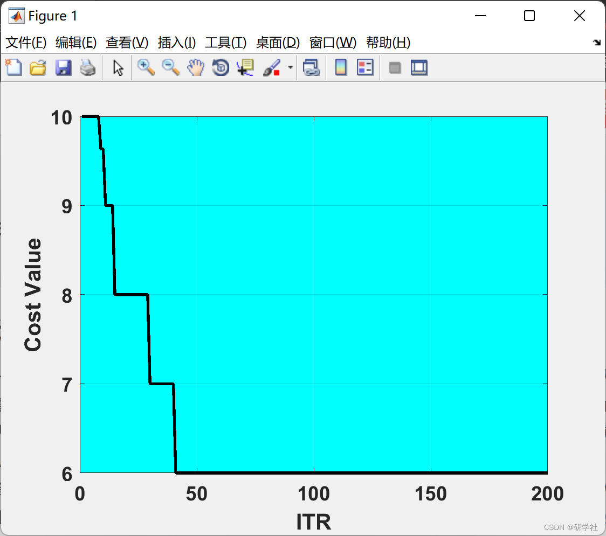

# Optimization Algorithm for Packing Problem Based on Weevil Damage (Matlab Code Implementation)

1. Edit
Then, this article solves the TSP problem based on the optimization algorithm for damage in spider weevils using Matlab code.
📚2 Run results edit
Part of the code:
% WDOA Parameters
MaxIt = 200;                                                                                                                                                                                                                                                                                                                                                                                                                                     
nPop = 10;       
DamageRate = 0.1;        
nweevil = round(DamageRate*nPop); 
nNew = nPop-nweevil;    
mu = linspace(1, 0, nPop); 
pMutation = 0.2;      
MUtwo = 1-mu;      
SnoutPower = 0.8; 
FlyPower = 0.03*(VarMax-VarMin);
%% Basics
% Empty weevil
weevil.Position = [];
weevil.Cost = [];
weevil.Sol = [];
% Weevils Array  
pop = repmat(weevil, nPop, 1);  
% First weevils  
for i = 1:nPop  
pop(i).Position = unifrnd(VarMin, VarMax, VarSize);  
[pop(i).Cost pop(i).Sol] = CostFunction(pop(i).Position);  
end;  
% Sort  
[~, SortOrder] = sort([pop.Cost]);pop = pop(SortOrder);  
% Best Solution  
BestSol = pop(1);  
% Best Costs Array  
BestCost = zeros(MaxIt, 1);  
%--------------------------------  
%% WDOA Body  
for it = 1:MaxIt  
newpop = pop;  
for i = 1:nPop  
for k = 1:nVar  
if rand <= MUtwo(i)  
TMP = mu;TMP(i) = 0;TMP = TMP/sum(TMP);  
j = RouletteWheelS(TMP);  
newpop(i).Position(k) = pop(i).Position(k)+SnoutPower*(pop(j).Position(k)-pop(i).Position(k));  
end;  
% Mutation  
if rand <= pMutation  
newpop(i).Position(k) = newpop(i).Position(k)+FlyPower*randn;  
end;end;  
% Apply Lower and Upper Bound Limits  
newpop(i).Position = max(newpop(i).Position, VarMin);  
newpop(i).Position = min(newpop(i).Position, VarMax);  
[newpop(i).Cost newpop(i).Sol] = CostFunction(newpop(i).Position);  
end;% Asses power  
[~, SortOrder] = sort([newpop.Cost]);newpop = newpop(SortOrder);% Sort  
pop = [pop(1:nweevil);newpop(1:nNew)];% Select  
[~, SortOrder] = sort([pop.Cost]);pop = pop(SortOrder);% Sort  
BestSol = pop(1);% Update  
BestCost(it) = BestSol.Cost;% Store  
% Iteration  
disp(['In Iteration No ' num2str(it) ': WDOA Best Cost = ' num2str(BestCost(it))]);  
end  
% Results
figure;
plot(BestCost,'k', 'LineWidth', 2);
xlabel('ITR');
ylabel('Cost Value');
ax = gca;
ax.FontSize = 14;
ax.FontWeight='bold';
set(gca,'Color','c')
grid on;

% Statistics
items=model.v;
itemindex=BestSol.Sol.B;
sizebins=size(itemindex);
for i=1: sizebins(1,1)
    itemvalue{i}=items(itemindex{i});
end;
itemvalue=itemvalue';

% Display information
disp(['Number of Items is ' num2str(model.n)]);
disp(['Items are ' num2str(items)]);
disp(['Bins size is ' num2str(model.Vmax)]);
disp(['Selected bins is ' num2str(BestCost(end))]);
disp(['Selected bins indexes are ']);
itemindex
disp(['Selected bins values are ']);
itemvalue

🎉3 References
🌈4 Matlab Code and Article Reading

## Images

<!-- PAYMENT_BLOCK -->

## Get this dataset

- Payment link (Stripe): [Buy now](https://buy.stripe.com/3cs8yP7sY87d0vu9AB)
- Payment QR code: 

<!-- /PAYMENT_BLOCK -->
